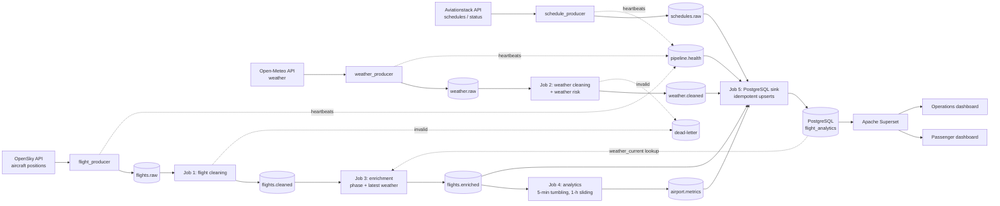

# Architecture

One streaming pipeline feeds both dashboards; they differ only in which tables/views they query.

Kafka is the transport layer, Flink does the processing, PostgreSQL stores results, Superset only
queries PostgreSQL.

## Key design choices

| Choice | Reason |
|---|---|
| Separate Kafka topics per stage | each stage can be inspected and replayed independently |
| Dead-letter topic | invalid records are kept with a reason, not silently dropped |
| Event-time windows + watermarks | results follow when events happened, not when they arrived |
| Deterministic keys + JDBC upserts | replays and duplicate API polls cannot create duplicate rows |
| Processing-time JDBC lookup for weather | low latency; trade-off documented in `flink_jobs/flight_enrichment.py` |
| Delay metrics from schedule data in SQL views | positions cannot yield delays; views always reflect the latest flight state |
| Rules shared by Python and Flink SQL (`config/rules.py`) | thresholds are defined once |
| `MOCK_MODE` | develop and demo without API keys; records are labelled `source = "mock"` |

## Ports

Kafka UI 8080 · Flink UI 8081 · Superset 8088 · PostgreSQL 5432 · Kafka (host) 29092
